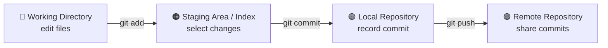
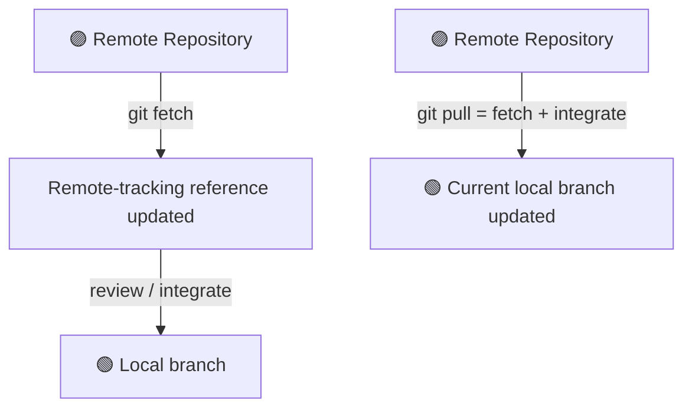

# Day 1 — Foundations, mental model and first repository

## Part A — Pre-Lesson

- **Lesson topic:** Day 1 — Foundations, mental model and first repository
- **Estimated learning time:** Approximately 60–120 minutes; split across sessions as needed.
- **Learning objectives:** Explain why version control exists; distinguish local, centralised and distributed version control; explain Git vs GitHub; describe repositories, the working directory, staging area, commits, branches and HEAD; install/configure Git; create and inspect a first local repository.
- **Prerequisites:** Windows computer; Git Bash available or ready to install. No prior Git knowledge required.
- **Scope:** Version control foundations; Git's distributed model; Git vs GitHub and hosting; repository anatomy; file lifecycle/states; commits, parent commits, hashes, branches and HEAD; Git installation/configuration; first repository; status, add, commit, log and diff.
- **Planned practical / deliverable (deferred):** Create `git-learning-journey` with a README, Day 1 notes and a commands file; make at least two meaningful commits. Do not assign or request this practical until the learner explicitly opts in.
- **Verification criteria:** Explain core terms in your own words, distinguish Git from GitHub, identify the role of the working directory/index/local repository, run the first-repository workflow, interpret status/diff/log output and answer the Day 1 quiz/interview prompts. These are acceptance criteria, not a statement that they have already been met.

## Part B — Lesson / Study Material

The actual teaching starts immediately below. Follow the topics in order; do not insert course-status or evidence tables into the teaching flow.

## Topic 1 — Why Version Control Exists

*Teach the problem of manual backups, change history, collaboration, rollback and traceability before moving to the next topic.*

## Topic 2 — Version Control Models: Local, Centralised and Distributed

*Teach the models, their trade-offs and Git's distributed model here.*

## Topic 3 — Git vs GitHub and Hosting Platforms

*Explain the version control tool, hosting/collaboration platform and alternatives here.*

## Topic 4 — Repository Anatomy and Git's Four Workflow Areas

Git work usually moves through four distinct places. Understanding these areas explains what each everyday command actually does.

### 1. Working Directory — where you edit files

The working directory (also called the working tree) is the checked-out project on your computer. You open files, create new ones, edit content and delete files here.

- A new file here is usually **untracked** until Git is told to track it.
- An edit to a tracked file appears as a modification in the working directory.
- Editing a file does not automatically stage or commit it.

### 2. Staging Area — the proposed next snapshot

The staging area, also called the **index**, is the collection of changes selected for the next commit. It lets you choose exactly what belongs together in a snapshot.

- `git add <file>` copies the file's current content into the index.
- You can stage some files and leave other changes unstaged.
- If you edit a file again after staging it, the newer edit is not automatically included in the already staged version; stage it again if it should be part of the next commit.

### 3. Local Repository — saved project history

The local repository is the Git database in the project's `.git` directory. It stores commits and the objects and references that make the history work.

- `git commit` creates a new commit from the staged snapshot and connects it to its parent history.
- A commit is a durable local history point; it is not automatically uploaded to GitHub.
- You can create and inspect local commits without an internet connection.

### 4. Remote Repository — shared copy hosted elsewhere

A remote repository is another repository copy, commonly hosted on GitHub, that your local repository knows how to communicate with.

- `git push` sends local commits to a remote branch, when the update is permitted.
- `git fetch` downloads remote objects and updates remote-tracking references without merging them into the current branch.
- `git pull` fetches and then integrates the fetched changes into the current branch (commonly by merge, depending on configuration).

### The four areas at a glance

| Area | What happens there | Typical action |
|---|---|---|
| 🔵 Working Directory | Create and edit project files | Edit in your editor |
| 🟠 Staging Area / Index | Select changes for the next snapshot | `git add` |
| 🟢 Local Repository | Record and inspect local history | `git commit`, `git log` |
| 🟣 Remote Repository | Share and receive commits | `git push`, `git fetch`, `git pull` |

### Visual: the normal local-to-remote path



The first three areas are on your computer. The remote is another repository, usually on a hosting service such as GitHub. A commit can exist locally before it exists on the remote.

### Visual: receiving other people's work



### How the commands differ

| Command | Main job | Does it create a commit? | Does it contact the remote? |
|---|---|---:|---:|
| `git add` | Select content for the next commit | No | No |
| `git commit` | Save staged content in local history | Yes | No |
| `git push` | Publish local commits | No | Yes |
| `git fetch` | Download remote updates without integrating them into the current branch | No | Yes |
| `git pull` | Fetch, then integrate remote updates | Usually no new commit for a fast-forward; a merge may create one | Yes |

**Important distinction:** `git fetch` is the safer inspection-first choice when you want to learn what arrived before integrating it. `git pull` performs the integration step too.

### Instructor-led example (illustrative only)

Assume a repository has a tracked file named `README.md` and you edit it.

```bash
git status
git add README.md
git status
git commit -m "Update project README"
git log --oneline -1
git push
```

What each step means:

1. The first `git status` reports the working-tree change.
2. `git add README.md` stages the current version of that file.
3. The second `git status` shows the staged change.
4. `git commit` records the staged snapshot in local history.
5. `git log --oneline -1` displays the newest local commit.
6. `git push` attempts to publish the commit to the configured remote branch.

Expected output varies with repository state, branch name, remote configuration and Git version. These commands are an instructor demonstration, not a claim that the learner ran them.

### Common misunderstandings

- **“Saving a file commits it.”** No. Saving edits the working directory; staging and committing are separate actions.
- **“git add uploads my file to GitHub.”** No. It stages content locally.
- **“git commit sends my work to GitHub.”** No. It creates local history.
- **“git fetch changes my files.”** Fetch updates downloaded objects and remote-tracking references; it does not integrate those changes into the current branch.
- **“git pull and git fetch are identical.”** Pull includes fetch plus an integration step.

### Mental model to retain

Think of the workflow as preparing a package: the working directory is your workbench, the index is the exact set of items packed for the next snapshot, the local repository is your saved history, and the remote repository is the shared copy. Each command moves information across a particular boundary; none of these boundaries should be treated as interchangeable.


## Topic 5 — File States, Commits, Branches and HEAD

*Teach tracked/untracked/modified/staged/committed states, snapshots, parents, object IDs, branch pointers and HEAD here.*

## Topic 6 — Install and Configure Git on Windows

*Demonstrate Git for Windows, Git Bash, version checks, identity configuration and configuration scopes. Explain PowerShell/CMD differences where relevant.*

## Topic 7 — Create and Inspect the First Repository

*Demonstrate mkdir/cd, git init, README creation, git status, git add, git commit, git log and a second change inspected with git diff. Separate commands from illustrative expected output.*

## Topic 8 — Day 1 Practical, Review and Knowledge Check (deferred until opt-in)

*This section preserves the planned practical, troubleshooting, independent challenge, quiz and interview coverage. Do not present or assign any of these activities until the learner explicitly opts in to the relevant activity. Concept teaching may continue meanwhile.*

---

## Verification Record — update only from learner evidence

### Session records
| Session/date | Topics taught | Learner attempt / evidence | Status | Next step |
|---|---|---|---|---|
| 2026-11-01 — Session 1 | Day 1 topics 1–8 introduced | No learner terminal output or practical evidence supplied | Introduced | Verify Git installation/configuration, then complete first-repository practical |

### Commands demonstrated vs actually run
- Instructor demonstrated: `git --version`, `git config`, `pwd`, `ls`, `cd`, `mkdir`, `git init`, `git status`, `git add`, `git commit`, `git log`, `git diff`.
- Commands run by learner (with supplied evidence): None confirmed.
- Output/evidence reviewed: None yet.

### Quiz and interview outcomes
- Quiz score and topic gaps:
- Interview answers and feedback:
- Remediation / retest:

### Continuation checkpoint
- Topics Introduced: Day 1 topics 1–8. Practised: none. Verified: none.
- Topics needing revision: To be determined from learner responses and practical evidence.
- Blockers: Git installation/configuration unconfirmed; original 23-page Master Planner DOCX not attached.
- Exact next topic/task: Continue concept-by-concept Day 1 teaching. Do not request terminal output or assign the first-repository practical until the learner explicitly opts in.

Do not mark Day 1 verified until its required syllabus, practical deliverable and understanding/application checks have been reviewed. A topic heading, instructor demonstration or displayed exercise is not evidence of learner completion.


## Teaching pace — concept by concept

This day is intentionally taught across multiple turns/sessions. Do not deliver all eight topics, the complete practical, quiz and interview bank in one response.

- Teach one main concept at a time (or a small, closely related group of subtopics).
- After each concept, pause for learner questions or a focused understanding/practice check; review the response before moving forward.
- Keep all remaining topics in this file and teach them progressively in the listed order. Do not omit or prematurely compress them.
- The full Day 1 quiz and interview practice remain planned after the relevant teaching; administer them only when the learner explicitly opts in to each activity.
- The next concept is determined by the learner's checkpoint and readiness, not by an attempt to finish the whole day in one sitting.

Default rhythm: explain → visual/mental model → focused demonstration → expected output → learner check → feedback → next concept.


## Learner permission gate — no practicals or assessments by default

For this Day 1 record, and for all future teaching, do not give the learner quizzes, tests, interview questions, practical tasks, command-running exercises, homework or assessments unless the learner explicitly asks to begin them. Teach the concepts deeply first, one at a time. Instructor demonstrations may be shown as illustrations, but do not ask the learner to execute them or submit evidence without permission.

"Continue" or "next topic" means continue concept teaching; it does not authorise a quiz or practical. If the learner asks to move into an assessment/practical before the concepts are adequately taught, remind them of their preference and ask for explicit confirmation before starting. Permission for one activity does not authorise the others.

**Current teaching mode:** concept explanation only. The next teaching turn should continue the next appropriate concept; do not request terminal output as a practical checkpoint yet.

## Learner-controlled practice and assessment — mandatory consent gate

**Default mode is concept teaching only.** Do not give or assign quizzes, tests, assessments, interview questions, mock interviews, practicals, command-running tasks, homework, challenges, exercises or deliverables unless the learner explicitly asks to begin that specific activity.

- Teach concepts thoroughly first, one concept at a time. Do not interpret "continue", "next topic", moving to another day/module, or asking for more explanation as permission to assess or assign practical work.
- Do not insert a "quick check", knowledge check, prediction question, interview prompt or one-question quiz during concept teaching. Explanations and instructor-led demonstrations are allowed; learner execution is not requested by default.
- The learner may ask conceptual questions at any time. You may include worked examples and model-answer explanations as part of teaching when useful, without turning them into an assessment.
- If the learner tries to move ahead to a later day/module while previously planned quizzes or assessments remain incomplete, gently remind them that those activities are still pending and ask whether they want to continue concept learning or explicitly begin a particular assessment. Do not start it without clear permission.
- If the learner explicitly asks to begin one activity (for example, "quiz me now" or "start the practical"), that permission applies only to that activity. It does not authorise other activity types.
- If the learner requests study mode, questions with answers, or model answers, provide them as requested; do not misrepresent this as an attempted assessment.
- Preserve all planned quizzes, assessments, practicals and deliverables in the curriculum. Defer their administration until explicit opt-in; do not delete or silently skip them.
- Record only activities actually authorised and undertaken. A demonstrated command is not learner execution. Do not mark Practised or Verified without learner evidence and review.

**Reminder rule:** if the learner advances to a later day or lesson without completing previously deferred quizzes/assessments/practicals, remind them of the pending activities before proceeding. Respect their choice if they explicitly choose to continue learning concepts first.

This rule overrides any older wording that schedules automatic quizzes, interview practice, exercises, practicals or deliverables at the end of a lesson.


## Latest learner preference — concept-only mode by default

Continue Day 1 by teaching one concept at a time. Do not assign or ask the learner to complete quizzes, interview questions, practicals, command-running exercises, homework, challenges or deliverables unless the learner has learned the relevant concepts and explicitly opts in to that specific activity. Instructor-led demonstrations, worked examples and questions-with-answers as explanations are allowed. Do not use “quick checks”, output predictions or explain-back prompts as hidden assessments. “Continue” means continue teaching concepts. If the learner moves to Day 2 or another module while Day 1 practicals/assessments remain pending, remind them that these are deferred and ask whether they wish to continue concept learning or explicitly begin a particular activity. This rule overrides older Day 1 instructions that suggest learner checks or practical work by default.