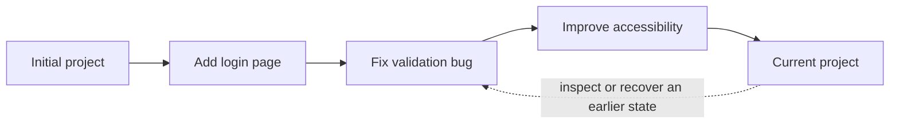

# Topic 1 — Why Version Control Exists

**Course:** Day 1 — Foundations and first repository  
**Status of this note:** Reconstructed study reference for a topic previously taught. It does not represent a new practical attempt or verification.

## 1. Definition

Version control is a system for recording and managing changes to files over time. It lets a person or team understand what changed, when it changed, why it changed and how to return to an earlier known state.

A version-control system (VCS) is especially useful for source code, but the same idea applies to documentation, configuration, scripts and other text-based project files.

## 2. The problem without version control

Imagine editing a project for several weeks. Without a reliable history, you may have only the current files and manually copied folders such as:

- `website-final/`
- `website-final-new/`
- `website-final-really-new/`
- `website-final-fixed/`

This approach is fragile. It is difficult to know which folder is authoritative, what changed between copies, who made a change, or how to restore only one earlier file. A manual copy is also easy to overwrite or forget.

Version control replaces this uncertain collection of copies with a structured history of changes.

## 3. What version control gives you

### Change history
A VCS records a sequence of meaningful project states or changes. You can inspect the evolution of a file or project instead of relying on memory.

### Comparison
You can compare versions to see what was added, removed or modified. This makes code review and debugging more reliable.

### Rollback and recovery
If a change introduces a bug, history helps you identify the responsible change and return to a known-good state. Recovery should be deliberate: undoing a change is not the same as deleting history.

### Collaboration
Multiple people can work on the same project. Version control provides a basis for combining their contributions and resolving overlapping edits.

### Traceability and accountability
A change can be associated with an author, time, description and surrounding project history. This helps teams understand why a change exists and audit how a project evolved.

### Safer experimentation
Developers can explore an idea without making the stable version their only copy. Later topics explain branches and other mechanisms for isolating work.

### Backup and distribution (with an important qualification)
A remote repository can provide another copy of the project history and make it accessible to a team. However, version control is not a complete backup strategy by itself: remote access, retention, credentials and independent backups still matter.

## 4. Mental model: a timeline of project states

Think of version history as a timeline. Each recorded point gives you a reference to a known project state, and the history explains how the project reached that point.

This is a conceptual timeline, not a claim that every VCS stores a full independent copy at each point. Different systems represent history differently; Git's snapshot and object model is covered later.

## 5. Where version control is used professionally

- Application source code and libraries.
- Infrastructure-as-code and deployment configuration.
- Documentation and technical specifications.
- Data pipelines, scripts and automation.
- Team-based open-source and enterprise development.

Version control is valuable even for a solo developer: it provides a reliable record and makes experimentation safer.

## 6. What version control does not automatically guarantee

- It does not prove that the code is correct or secure.
- It does not replace testing, code review or deployment controls.
- A local repository is not automatically backed up to another machine.
- A commit message is useful only when it accurately explains the change.
- A recorded change can still contain a bug or a secret; history must be managed responsibly.

## Topic recap

Version control gives a project a reliable, inspectable history. Its core benefits are change tracking, comparison, recovery, collaboration and traceability. Git is one distributed version-control system; hosting platforms add sharing and collaboration services around repositories.
