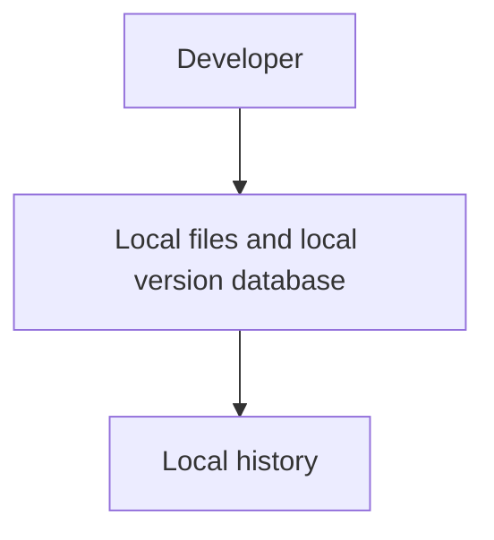
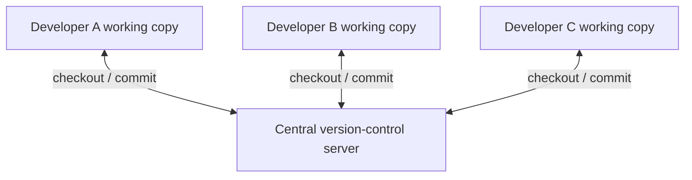
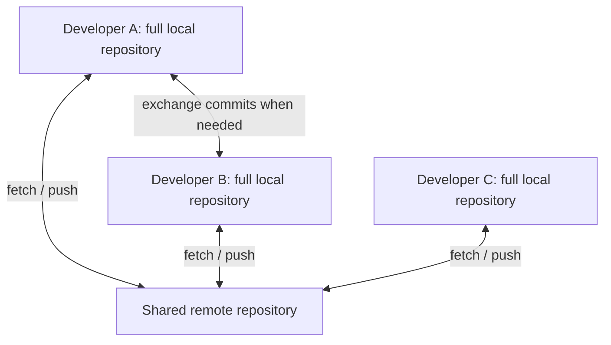

# Topic 2 — Version-Control Models: Local, Centralised and Distributed

**Course:** Day 1 — Foundations and first repository  
**Status of this note:** Reconstructed study reference for a topic previously taught. No learner command execution or practical verification is implied.

## 1. Why there are different models

Version-control systems differ in where the authoritative history is stored and how people exchange changes. The three foundational models are local, centralised and distributed.

## 2. Local version control

In a local model, version history is maintained on one computer. A developer can record and inspect changes without relying on a network server.

**Strengths**
- Simple and available offline.
- No central server is required for one person's history.

**Limitations**
- Collaboration is not built into the model.
- If the computer and its storage are lost, the history may be lost unless separately backed up.
- Sharing and combining work across developers requires additional mechanisms.

## 3. Centralised version control (CVCS)

A centralised model uses a shared server that stores the central project history. Developers typically connect to it to obtain the latest files and submit their changes.

Examples of centralised systems include Subversion (SVN) and older workflows built around a single central repository.

**Strengths**
- A central place to manage shared history and access.
- A familiar, straightforward model for teams that require central coordination.

**Limitations**
- Many operations depend on server connectivity.
- The central server is an important availability and failure point.
- A developer's working copy usually does not contain the complete project history.

## 4. Distributed version control (DVCS)

In a distributed model, each developer's clone contains the repository history, not merely the latest working files. Developers can record commits and inspect local history while offline, then exchange changes with other repositories.

Git is a distributed version-control system. GitHub is commonly used as a hosted remote and collaboration service, but Git itself does not require GitHub.

**Strengths**
- Local commits, history inspection and many other operations work offline.
- Every full clone contains substantial history, so there are multiple copies of repository data.
- Developers can work independently and exchange commits through different remotes.
- Teams are not required to use one particular hosting provider.

**Trade-offs**
- Multiple histories and parallel work require integration decisions.
- Teams need conventions for branches, reviews, synchronisation and resolving conflicts.
- A clone is not necessarily a complete backup of every uncommitted file or every external system.

## 5. Comparison

| Dimension | Local VCS | Centralised VCS | Distributed VCS |
|---|---|---|---|
| Main history location | One local computer | Central server | Full repository copies across clones |
| Offline commits | Yes | Usually limited/not the normal model | Yes |
| Collaboration | Not inherent | Through central server | Through repository-to-repository exchange |
| Server dependency | No central server | Stronger dependency | Not required for local commits |
| Example | Local revision database | SVN | Git |

## 6. Important distinction: distributed does not mean uncoordinated

A distributed system allows independent local work, but teams still need a shared collaboration process. A hosted remote such as GitHub often becomes the team's shared meeting point. Pull requests, reviews, protected branches and CI checks provide coordination around the distributed Git repositories.

## 7. Professional relevance

Understanding the model explains why a Git commit can be created without internet access, why pushing is a separate operation, why a clone contains history, and why a central hosted repository is useful without being the same thing as Git itself.

## Topic recap

- **Local:** history on one computer.
- **Centralised:** shared history primarily managed by a central server.
- **Distributed:** each full clone contains repository history and can create commits independently.
- **Git:** distributed VCS; hosting platforms are optional collaboration infrastructure.
