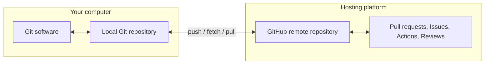

# Topic 3 — Git vs GitHub and Other Hosting Platforms

**Course:** Day 1 — Foundations and first repository  
**Note type:** Reconstructed study note for a topic previously taught. No account setup, repository creation or learner command execution is implied.

## 1. The central distinction

**Git is a version-control tool. GitHub is a service that hosts Git repositories and adds collaboration features.** They are related, but they are not the same product.

Git can manage a repository entirely on your computer. GitHub becomes useful when you want to host a repository remotely, share it, collaborate or use platform features.

## 2. What Git does

Git is software installed on a computer. It manages the repository's local working state and history. It provides capabilities such as:

- Recording commits.
- Comparing versions and inspecting history.
- Creating and switching branches.
- Merging work and helping resolve conflicts.
- Connecting a local repository to one or more remotes and exchanging commits.

Git's core operations do not require a GitHub account or an internet connection.

## 3. What GitHub adds

GitHub is a web-based hosting and collaboration platform for Git repositories. It provides a remote location for repository data and features such as:

- Repository hosting and access controls.
- Pull requests and code review.
- Issues and project planning.
- GitHub Actions for automation and CI/CD.
- Releases, repository documentation and Pages.
- Security and dependency-management features.

The Git repository contains version history. GitHub provides a hosted place to share that repository and coordinate work around it.

## 4. How they work together

A typical relationship is:

1. Git manages the local repository.
2. A remote URL identifies a hosted repository.
3. Git can push local commits to that remote.
4. Git can fetch remote commits and references.
5. GitHub's web interface provides collaboration features around the hosted repository.

The exact commands and remote configuration are taught later.

## 5. GitHub is not the only hosting platform

| Platform | General role |
|---|---|
| GitHub | Git hosting and collaboration |
| GitLab | Git hosting, collaboration and integrated DevOps/CI features |
| Bitbucket | Git hosting and team collaboration, commonly integrated with Atlassian tools |
| Self-hosted Git services | Organisation-controlled hosting and access management |

The Git repository format and Git command-line concepts are not exclusive to GitHub. A hosting service may change while Git remains the version-control tool.

## 6. Common misconceptions

- **“GitHub is Git.”** No. Git is version-control software; GitHub is a hosting and collaboration platform.
- **“I need GitHub to use Git.”** No. Git works locally without an online account.
- **“A local commit automatically appears on GitHub.”** No. A local commit remains local until pushed to a configured remote.
- **“Every Git remote must be GitHub.”** No. A remote can be hosted on another service or another server.

## 7. Professional relevance

The distinction helps teams choose the right tool for each job: Git for version history and local source control; a hosting platform for shared repositories, review workflows, permissions, automation and collaboration. It also makes it possible to move a project between hosting providers without changing the fundamental Git concepts.

## Topic recap

**Git = version control.**  
**GitHub = hosted Git repositories plus collaboration features.**

Git is the underlying tool; GitHub is one of several services that can host and collaborate around Git repositories.
