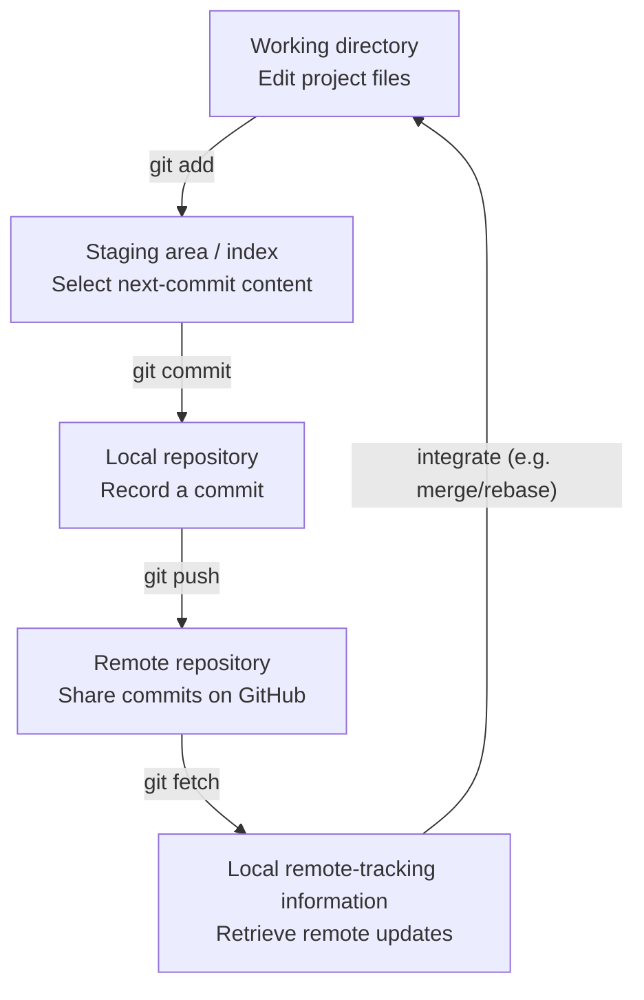

# Topic 4 — Repository Anatomy and the Four Workflow Areas

**Course:** Day 1 — Foundations and first repository  
**Scope:** Working directory/worktree, staging area/index, local repository and remote repository.

## 1. What is a Git repository?

A Git repository is a project whose history and version information are managed by Git. In a normal working repository, Git's internal database and metadata are stored in the hidden `.git/` directory. The project files you edit are separate from the internal repository data.

A repository can exist locally on your computer without any GitHub connection. Git's core version-control operations, including making commits, work offline.

## 2. The four workflow areas

| Area | What it contains | Main purpose |
|---|---|---|
| Working directory (worktree) | The checked-out project files and current edits | Where you create, delete and modify files |
| Staging area (index) | The proposed content for the next commit | Selects exactly which changes should enter the next commit |
| Local repository | Git objects and commit history in the local `.git/` database | Preserves committed project snapshots and history |
| Remote repository | A repository hosted elsewhere, such as GitHub | Shares history and supports collaboration/backup |

The staging area is not a separate server or a second project folder. It is Git's index: a record of the content selected for the next commit.

## 3. The basic movement of changes



- `git add` copies the selected current file content into the index; it does not upload it to GitHub.
- `git commit` creates a local commit from the staged snapshot; it does not automatically upload anything.
- `git push` sends local commits to a configured remote.
- `git fetch` retrieves remote objects and updates remote-tracking references, without automatically integrating those changes into the current branch.
- `git pull` fetches and then integrates remote changes into the current branch (commonly by merge, or by rebase when configured/requested).

## 4. Why staging exists

Staging gives precise control over commit contents. Suppose you edit `index.html` and `style.css`, but only the HTML change belongs in the next commit. You can stage the HTML change and leave the CSS change unstaged. The next commit is based on the index, not simply every change currently visible in the working directory.

Staging therefore supports small, focused, reviewable commits and lets you separate unrelated work.

## 5. Local commit versus GitHub

A commit is a version recorded in the local repository. It can exist even when the computer is offline. GitHub receives that commit only when it is pushed to a remote repository.

```bash
git add index.html
git commit -m "Add homepage"
git push
```

These are illustrative commands, not evidence that the learner ran them.

## 6. Common misunderstandings

- **`git add` does not mean upload.** It stages content locally.
- **`git commit` does not mean publish.** It records history locally.
- **A remote is not required to use Git.** Local repositories work independently.
- **The staging area is not the local commit history.** It is the proposed next snapshot.
- **Fetch and pull are not identical.** Fetch retrieves; pull retrieves and integrates.

## 7. Professional relevance

The four-area model helps developers reason about what is changed, what will be included in a commit, what has already been recorded locally and what has been shared with teammates. It is essential for avoiding accidental commits, understanding why GitHub does not show a local commit yet, and diagnosing sync problems.

## Topic recap

```text
Working directory --git add--> Staging area
Staging area      --git commit--> Local repository
Local repository  --git push--> Remote repository
Remote repository --git fetch--> Local remote-tracking information
```

**Key distinction:** add stages, commit records locally, push publishes to the remote.
