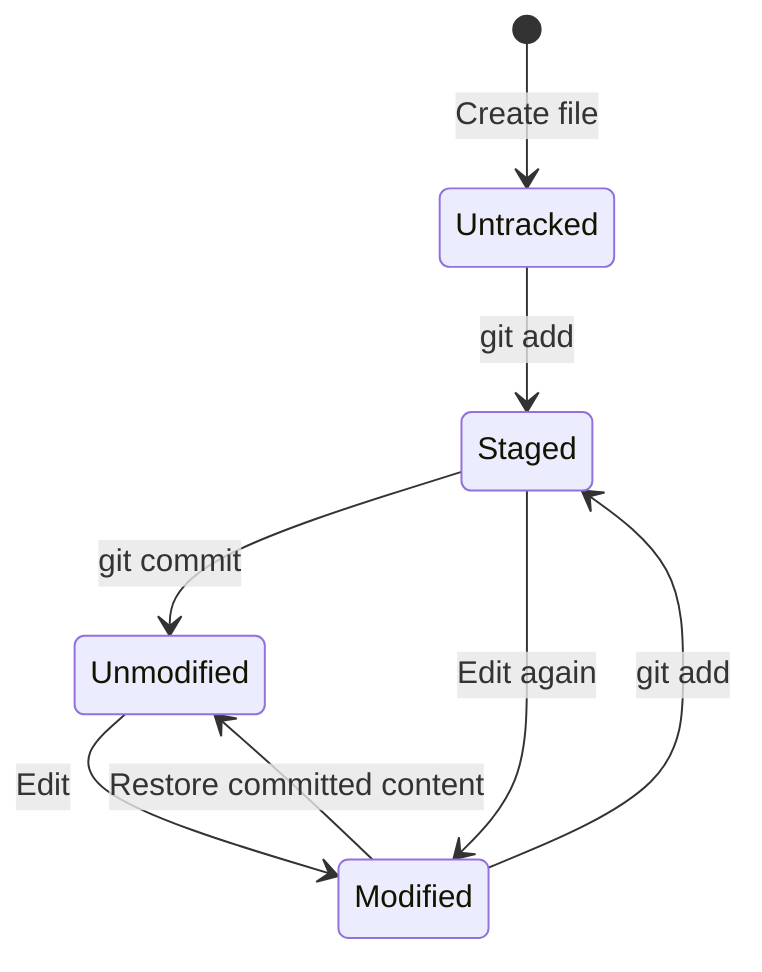
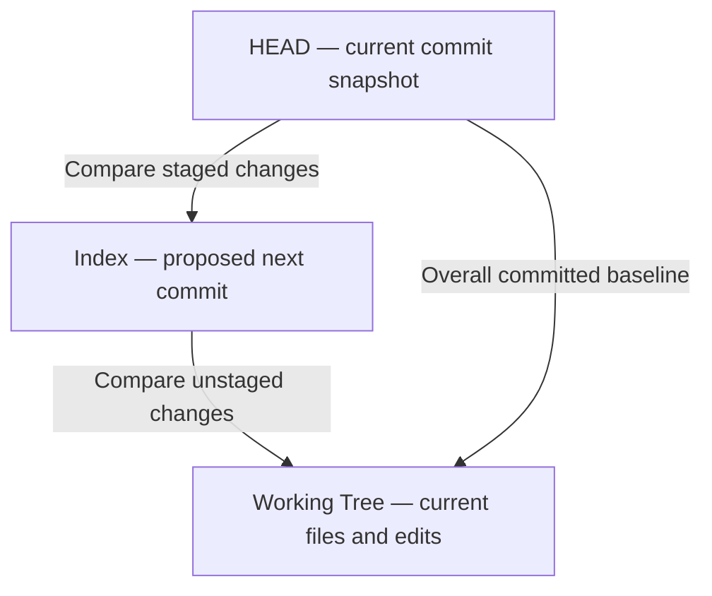
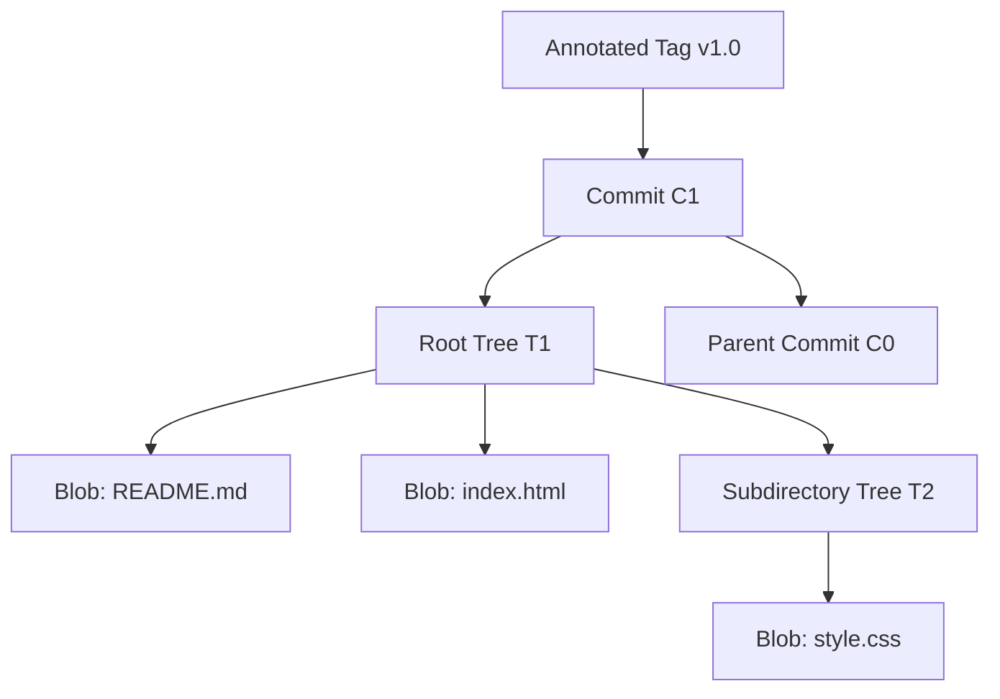
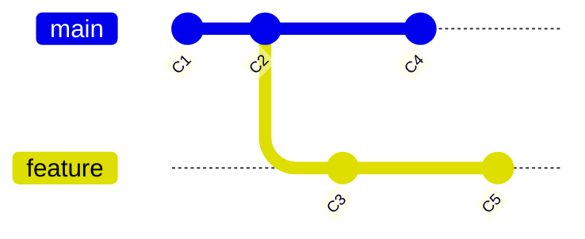

# Topic 5 — File States, Git Objects and the HEAD–Index–Working Tree Model

**Course:** Day 1 — Foundations and first repository  
**Scope:** File states/transitions, snapshots, Working Tree, Index, HEAD, Git objects, parent commits, object IDs and branches.

## 1. Git file states

Git commonly reports four states:

| State | Meaning |
|---|---|
| Untracked | A file exists in the working directory but is not yet tracked by Git |
| Unmodified | A tracked file matches its committed content |
| Modified | A tracked file differs from the staged or committed version in the working tree |
| Staged | A change has been recorded in the Index for the next commit |

A typical lifecycle is:



A file can have staged content and then be edited again. The Index retains the version staged earlier; the newer working-tree edits remain unstaged.

Illustrative `git status` output:

```text
On branch main

Changes to be committed:
  modified: index.html

Changes not staged for commit:
  modified: style.css

Untracked files:
  notes.txt
```

## 2. HEAD, Index and Working Tree

- **HEAD:** identifies the current checkout position. In ordinary branch-based work, HEAD is a symbolic reference to the current branch, which points to its tip commit.
- **Index:** the staging area; records the content and metadata selected for the next commit.
- **Working Tree:** the checked-out project files that the learner edits.



Useful comparisons:
- `git diff`: by default, Working Tree versus Index (unstaged changes).
- `git diff --staged` (also `--cached`): Index versus HEAD (staged changes).

## 3. Git's object model

Git stores repository data in an object database. The four principal object types are:

| Object | Responsibility |
|---|---|
| Blob | Stores file content; does not store the filename or directory path |
| Tree | Represents a directory and connects names/modes to Blob objects and nested Trees |
| Commit | Points to a root Tree, parent commit(s), author/committer metadata, timestamp information and message |
| Annotated Tag | A separate object with a target, tagger metadata, message and optional signature |

A simplified relationship:



A commit is a pointer to a project snapshot and its history, not simply a folder containing a full independent copy of every file. Trees describe the directory structure; Blobs hold file contents. Git can reuse identical content objects.

A lightweight tag differs from an annotated tag: it is a reference to an object rather than a separate tag object.

## 4. Object IDs and hashing

Git identifies objects by an object ID (OID), calculated from the object's type, length and content. Traditional repositories commonly use SHA-1; Git also supports SHA-256 repositories.

Conceptually:

```text
OID = hash(object type + length + content)
```

Consequences:
- Identical content with the same object format can reuse the same Blob object.
- Changing content normally produces a different OID.
- OIDs identify objects and help Git check content integrity.

The SHA-1 OID of an empty Blob is:

```text
e69de29bb2d1d6434b8b29ae775ad8c2e48c5391
```

## 5. Parent commits and history

A normal commit has one parent; an initial/root commit has no parent; a merge commit can have two or more parents. Following parent links produces a directed acyclic graph (DAG): relationships have direction and cannot loop back to the same commit.



In this example, main and feature diverge after C2. Their tips are different commits, but they share a common ancestor.

## 6. Branches and HEAD

A branch is a movable reference to a commit, not a separate project folder. When a new commit is made on a branch, that branch reference advances. Branches can share most of their history.

In normal branch-based work:

```text
HEAD -> refs/heads/main -> commit C3
```

After switching to feature:

```text
HEAD -> refs/heads/feature -> commit C5
```

In detached HEAD state, HEAD points directly to a commit rather than symbolically to a branch. Detached HEAD is introduced here and will be examined further in advanced troubleshooting.

## 7. Instructor-led command demonstrations

These commands are examples only; they are not evidence that the learner ran them.

| Command | Purpose |
|---|---|
| `git status` | Inspect file states |
| `git diff` | Compare Working Tree against Index |
| `git diff --staged` | Compare Index against HEAD |
| `git show --stat HEAD` | Inspect latest commit summary |
| `git log --oneline --graph --decorate --all` | Visualise available commit history and refs |
| `git cat-file -t HEAD` | Display the object type (normally `commit`) |
| `git cat-file -p HEAD` | Display commit object contents |
| `git cat-file -p HEAD^{tree}` | Display root Tree entries |
| `git hash-object README.md` | Calculate the Blob OID without storing it by default |
| `git hash-object -w README.md` | Calculate and write the object into the object database |

Illustrative outputs:

```text
$ git cat-file -t HEAD
commit
```

```text
$ git cat-file -p HEAD
tree <tree-oid>
parent <parent-oid>
author ...
committer ...

Add homepage
```

The exact OIDs and metadata vary by repository. `git cat-file` and `git hash-object` are plumbing-level commands; their broader use belongs to Advanced Module A.

## 8. Common misconceptions

| Misconception | Correct understanding |
|---|---|
| A branch is a separate folder | It is a movable reference to a commit |
| A Blob stores filename and content | A Blob stores content; Trees hold names and structure |
| A commit is just a full folder copy | It points to a root Tree and parent history |
| HEAD always means latest commit on main | HEAD identifies the current checkout position |
| `git add` uploads files | It updates the local Index |
| Every commit has exactly one parent | Root commits have none; merge commits can have multiple |
| `git diff` shows every kind of difference | Default diff compares Working Tree and Index |

## 9. Professional relevance

This model explains precise staging, focused commits, history traversal, branch creation and switching, object reuse, detached HEAD, and why local changes are not automatically part of a commit or published remotely.

## Recap

- Working Tree = current editable files.
- Index = proposed next-commit content.
- HEAD = current checkout position.
- Blob = content; Tree = structure; Commit = snapshot reference plus history; annotated Tag = named metadata object.
- Branches are movable references; commits form a DAG through parent links.

**Command provenance:** Commands above were instructor-demonstrated or explained. No learner terminal execution is evidenced by this note.
