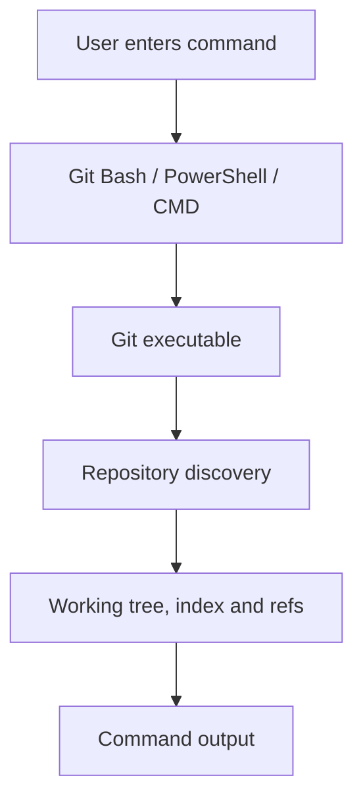

# Topic 6 — Install and Configure Git on Windows

**Course:** Day 1 — Foundations and first repository  
**Environment:** Windows 10/11; Git Bash is the primary learning shell  
**Mode:** Concept teaching and instructor demonstrations; no learner execution is evidenced.

## 1. What Git for Windows installs

Git for Windows provides the Git executable and supporting tools. Common components include Git Bash, Git GUI, Git Credential Manager and documentation.

- **Git** is the version-control engine.
- **Git Bash** is a Bash terminal environment through which Git and Unix-like utilities can be used.
- **PowerShell** and **CMD** are alternative Windows shells; Git commands can run in them too.
- Git Bash is not Git itself.

## 2. How a Git command runs

For `git status`, the shell locates the Git executable, Git inspects the current directory, discovers repository metadata where applicable, reads the relevant state and prints a report.



## 3. Installation choices

Important Git for Windows installer choices include:

- **Components:** supporting tools to install.
- **Default editor:** editor Git may open for commit messages and other text.
- **PATH environment:** determines whether shells can locate Git.
- **SSH executable / HTTPS backend:** connection components used by Git transports.
- **Terminal emulator:** terminal interface used by Git Bash.
- **Line-ending conversion:** behaviour when moving between Windows and Unix-style line endings.

If `git` is not recognised, Git may be missing or its executable directory may not be on PATH. A PATH issue does not prove Git is uninstalled.

## 4. Git Bash, PowerShell and CMD

| Environment | Typical directory listing | Typical current-directory command |
|---|---|---|
| Git Bash | `ls` | `pwd` |
| PowerShell | `Get-ChildItem` | `Get-Location` |
| CMD | `dir` | `cd` |

Git commands such as `git status` work in all three when Git is accessible.

## 5. Git configuration scopes

Git configuration is layered:

| Scope | Typical file | Reach |
|---|---|---|
| System | Installation's `etc/gitconfig` | All users on the computer |
| Global | `~/.gitconfig` or `~/.config/git/config` | Current OS user |
| Local | Repository's `.git/config` | One repository |

The ordinary precedence is system, global, then local; more specific values override less specific ones. Worktree, environment and command-level configuration can add further overrides.

Useful commands:

```bash
git config --list
git config --show-origin --list
git config --global --list
git config --local --list
git config user.name
```

`--show-origin` helps identify which configuration file supplied a value.

## 6. Identity and common settings

Set the global commit identity:

```bash
git config --global user.name "Your Name"
git config --global user.email "your-email@example.com"
```

These values are commit metadata; they do not authenticate the user to GitHub.

Other settings:

```bash
git config --global init.defaultBranch main
git config --global core.editor "code --wait"
git config --global core.autocrlf true
```

- `init.defaultBranch` sets the initial branch name for newly initialised repositories; it does not rename existing branches.
- `core.editor` selects the editor Git launches. VS Code's `--wait` makes Git wait for the editor to close.
- `core.autocrlf` controls common Windows/Unix line-ending conversion behaviour. With `true`, Git commonly converts LF to CRLF on checkout and CRLF to LF when staging. With `input`, it converts CRLF to LF on staging without converting LF to CRLF on checkout.
- Teams may prefer repository-level `.gitattributes` rules for consistent line endings.

## 7. Git identity versus GitHub authentication

- **Git identity:** who is recorded as author/committer in commit metadata (`user.name`, `user.email`).
- **GitHub authentication:** whether the client is authorised to access GitHub.

HTTPS commonly integrates with Git Credential Manager. SSH uses a key pair: the private key stays local and the public key is registered with the hosting service. These mechanisms are covered in greater depth on Day 4.

Never share passwords, personal access tokens or private SSH keys.

## 8. Common problems

| Symptom | Possible cause |
|---|---|
| `git: command not found` | Git absent or not discoverable through PATH |
| Git works in Git Bash but not another shell | Different PATH/environment state |
| Wrong name/email in commits | Configuration value overridden at another scope |
| Editor fails to open | Incorrect `core.editor` command |
| Unexpected line-ending diffs | Inconsistent conversion settings or attributes |
| Push requests authentication | HTTPS/SSH credentials not configured |

## 9. Instructor-demonstrated commands

| Command | Purpose |
|---|---|
| `git --version` | Display installed Git version |
| `git config --global user.name "Your Name"` | Set global identity name |
| `git config --global user.email "you@example.com"` | Set global identity email |
| `git config --global init.defaultBranch main` | Set default initial branch |
| `git config --global core.editor "code --wait"` | Set editor |
| `git config --global core.autocrlf true` | Configure line-ending conversion |
| `git config --list` | Display effective configuration |
| `git config --show-origin --list` | Display configuration and source |
| `git config --local --list` | Display repository configuration |

These are instructor examples, not evidence that the learner ran them.

## Recap

- Installation makes Git and its supporting tools available.
- Git Bash is a shell; Git is the version-control engine.
- PATH helps shells locate the Git executable.
- System, global and local scopes control configuration reach and precedence.
- Commit identity is distinct from GitHub authentication.
- Line-ending and editor settings can prevent cross-platform and workflow problems.

**Evidence:** Topic taught in concept mode on 2026-11-11. Learner installation, configuration, command execution and practical completion remain unconfirmed.
