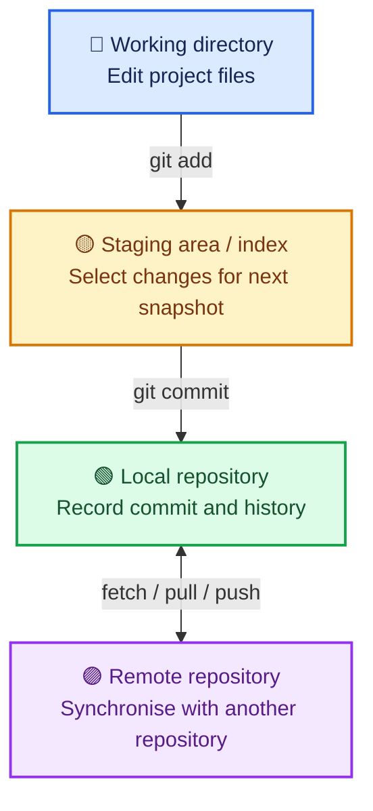
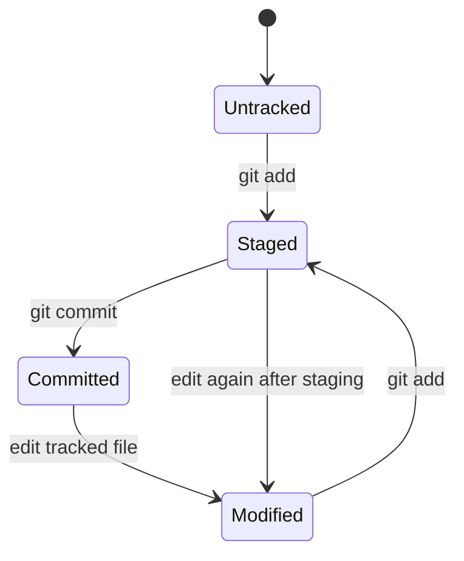

# Day 1 — Foundations, mental model and first repository

> **This file is the lesson.** The material below teaches the concepts and practical workflow. Verification status, learner evidence and the current next checkpoint are maintained separately in [COURSE_STATUS.md](../COURSE_STATUS.md) and [SYLLABUS_TRACKER.md](../SYLLABUS_TRACKER.md).

## Learning objectives

By the end of Day 1, you should be able to explain why version control is needed, compare version-control models, distinguish Git from GitHub, describe Git's core areas and file states, explain commits/branches/HEAD, verify a Git installation, configure an identity safely and create a local repository with meaningful commits.

## 1. Why version control exists

Imagine developing a website over several days. Without version control, you might keep files such as `index-final.html`, `index-final-new.html` and `index-final-fixed.html`. It becomes difficult to identify the right version, understand what changed, collaborate or recover earlier work.

**Version control** records a project's change history so that changes can be inspected, compared, shared and, when necessary, recovered.

## 2. Local, centralised and distributed version control

| Model | How it works | Typical trade-off |
|---|---|---|
| Local | History lives on one computer | Simple, but collaboration and off-device backup need additional mechanisms |
| Centralised | Clients work with a central server | Shared source of truth, but many operations depend on server access |
| Distributed | Each clone has its own repository and history | Many operations work offline; repositories synchronise when connected |

Git is a **distributed version control system (DVCS)**. You can create commits, inspect history and compare local changes without being connected to GitHub.

## 3. Git versus GitHub

| Git | GitHub |
|---|---|
| Version-control software | Hosted development and collaboration platform |
| Runs on your computer | Provides online repositories and collaboration features |
| Records project history | Hosts repositories and supports pull requests, issues, Actions and more |
| Local operations work offline | Online collaboration requires connectivity |

Git is the version-control engine. GitHub is one service that hosts Git repositories. GitLab and Bitbucket are other hosting/collaboration platforms.

## 4. Git's core areas

A useful mental model is: edit files, select the changes for a snapshot, then save that snapshot in local history.



- **Working directory / worktree:** your checked-out project files where editing happens.
- **Staging area / index:** the prepared set of changes for the next commit. You can stage some files or parts of files without staging every change.
- **Local repository:** Git's database and references, normally stored under the hidden `.git` directory.
- **Remote repository:** another repository, often hosted on GitHub. `git init` does not automatically create a remote.

## 5. File states and commits

| State | Meaning |
|---|---|
| Untracked | Git sees a file that is not yet tracked |
| Modified | A tracked file differs from the version recorded in the relevant snapshot |
| Staged | A change is in the index and prepared for the next commit |
| Committed | The staged project snapshot has been recorded in repository history |

These are useful descriptions, not always a single mutually exclusive state for an entire file. For example, a file can have staged changes and then be edited again, leaving additional unstaged changes.



A **commit** records a snapshot of the index plus metadata. A commit includes an object ID (hash), message, author/committer information, timestamps and parent reference(s). An initial commit has no parent; an ordinary commit normally has one parent; a merge commit can have multiple parents.

A **branch** is a movable reference to a commit. **HEAD** normally identifies the currently checked-out commit, commonly through the current branch.

Example simplified history:

```text
A1 ---- B2 ---- C3  (main)
                  ^
                 HEAD
```

## 6. Verify and inspect Git installation

Open **Git Bash** on Windows. Run:

```bash
git --version
```

Expected output resembles:

```text
git version 2.x.x.windows.1
```

The exact version will vary. If Git Bash says `git: command not found`, Git may not be installed or may not be on PATH.

Inspect global configuration:

```bash
git config --global --list
git config --global user.name
git config --global user.email
pwd
```

The final command prints the current working directory. The config commands inspect settings; they do not change them. If no global configuration exists, that is not by itself an installation failure.

Git configuration scopes:

| Scope | Applies to |
|---|---|
| `--system` | All users of the computer |
| `--global` | Your user account |
| `--local` | The current repository |

Configure an identity only after deciding what name and commit email you want recorded:

```bash
git config --global user.name "Your Name"
git config --global user.email "you@example.com"
```

These values identify commit authorship; they are not your GitHub password or access token. You may use a GitHub-provided noreply address to avoid publishing your personal email in commits. Never share tokens, passwords or private keys.

## 7. Create your first local repository

Use Git Bash. The following is an instructor demonstration: it shows the workflow and expected result; it does **not** mean the commands have been run on your computer.

From a directory where you keep learning projects:

```bash
mkdir git-learning-journey
cd git-learning-journey
git init
```

Git creates a local repository in the new folder. Depending on Git's initial-branch configuration, the default branch name may vary. Do not worry about changing it yet.

Create a README file (using VS Code or a text editor) with a short project description. Then inspect the state:

```bash
git status
```

Expected status will indicate that `README.md` is untracked.

Stage the file and inspect again:

```bash
git add README.md
git status
```

Now Git should report that `README.md` is staged for commit.

Create the first commit:

```bash
git commit -m "Add project README"
```

Inspect history:

```bash
git log --oneline
```

Expected shape (the hash and message are examples):

```text
a1b2c3d Add project README
```

Make a meaningful second change to README, save it, and inspect the unstaged difference:

```bash
git diff
```

Stage and commit that second change:

```bash
git add README.md
git commit -m "Describe learning goals"
git log --oneline
```

You should now see two commits. A commit message should describe the meaningful change, not merely say `update` or `changes`.

## 8. What the main commands do

| Command | Purpose | Effect |
|---|---|---|
| `git --version` | Check installed Git version | Read-only |
| `git config` | Read or change Git settings | Changes settings only when given a value |
| `git init` | Initialise a repository in the current directory | Creates `.git` |
| `git status` | Inspect working tree and staging state | Read-only |
| `git add` | Put selected changes into the index | Changes staging area |
| `git commit` | Record the staged snapshot | Adds local history |
| `git diff` | Compare unstaged changes with the index | Read-only |
| `git log` | Inspect commit history | Read-only |

## 9. Common mistakes and troubleshooting

- **`git: command not found`:** verify Git for Windows installation and PATH; reopen Git Bash after installation.
- **`Author identity unknown`:** configure `user.name` and `user.email` at an appropriate scope.
- **Nothing to commit:** inspect `git status`; perhaps nothing changed or changes are already committed.
- **File remains untracked:** verify the filename and current directory; then stage it with `git add`.
- **Unexpected repository location:** run `pwd` and `git rev-parse --show-toplevel` (the latter works inside a repository).
- **Commit did not include a recent edit:** remember that a commit records the staged index. Stage the later edit and create another commit.

## 10. Practical exercise

Create `git-learning-journey` with this structure:

```text
git-learning-journey/
├── README.md
└── day-01/
    ├── concepts.md
    └── commands.md
```

Requirements:

1. Initialise a local repository.
2. Write a short README explaining the purpose of this learning repository.
3. Add notes covering Git, GitHub and the three core areas.
4. Record the commands you used and what each one did.
5. Make at least two meaningful commits.
6. Use `git status`, `git diff` and `git log --oneline` to inspect and verify your work.

Do not connect a remote yet; local repository fundamentals come first.

## 11. Interview preparation

Prepare your own explanation of:

1. What is Git, and why do development teams use it?
2. How does a distributed version control system differ from a centralised one?
3. What is the difference between Git and GitHub?
4. Explain the working directory, staging area and local repository.
5. What is a commit, and what information does it contain?
6. What are HEAD and a branch?
7. Why can a file have both staged and unstaged changes?

## 12. Revision summary

- Git is a distributed version control system.
- GitHub hosts Git repositories and supports collaboration; it is not Git itself.
- The working directory is where files are edited.
- The index/staging area selects content for the next commit.
- The local repository stores committed history.
- A commit records a snapshot of the index.
- A branch is a movable reference; HEAD identifies the current checkout.
- `git status` inspects state, `git add` stages, `git commit` records, `git diff` compares and `git log` displays history.

---

## Verification checkpoint (progress record only)

The current learner-specific checkpoint is maintained in [COURSE_STATUS.md](../COURSE_STATUS.md). Topic statuses live in [SYLLABUS_TRACKER.md](../SYLLABUS_TRACKER.md); dated evidence lives in [PROGRESS_LOG.md](../PROGRESS_LOG.md).

Do not infer that an instructor-demonstrated command was run by the learner. Day 1 is not Verified until setup, practical work, quiz and interview preparation have been reviewed.
