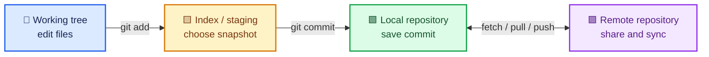
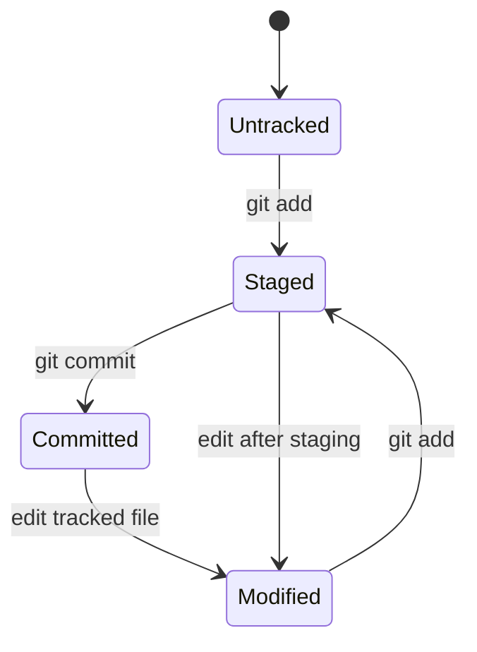
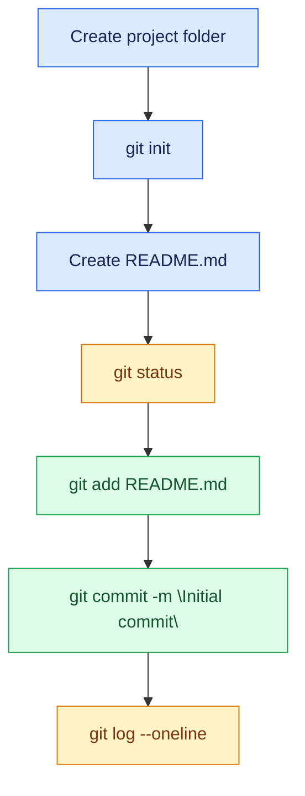

# Day 1 — Foundations, mental model and first repository

## Syllabus
- Version control and why it exists
- manual backups vs version history
- local, centralised and distributed version control
- Git's distributed nature
- Git history at a high level
- Git vs GitHub
- hosting platforms
- repository, working directory, index/staging area, local and remote repositories
- tracked/untracked/modified/staged/committed states
- commit, parent, hash/object ID, branch and HEAD
- install Git for Windows and verify git --version
- configure user.name/user.email and inspect config scopes
- create directory, git init, README, status/add/commit/log
- make second change and inspect git diff.

## Practical deliverable
Create git-learning-journey with README, day1 notes and commands file; make at least two meaningful commits.

## Interview focus
Define Git, DVCS, repository, commit and staging area; explain Git vs GitHub.

## Quiz focus
Definitions, repository states, command purpose and first-repository workflow.

## Session records
| Session/date | Topics covered | Status | Evidence | Next step |
|---|---|---|---|---|
| | | Not started | | |

## Commands demonstrated vs actually run
- Demonstrated:
- Run by learner:
- Output/evidence:

## Quiz and interview outcome
- Quiz score/gaps:
- Interview questions and answers:
- Remediation / revision:

## Continuation checkpoint
- Verified topics:
- Incomplete topics:
- Blockers:
- Exact next topic:

Do not mark this day verified until the syllabus, practical, quiz and interview preparation have been reviewed.

## Visual guide — how Git remembers work

### The four places to understand

### File-state transition

| Visual cue | Meaning |
|---|---|
| 🔵 Blue | Work is being edited |
| 🟡 Amber | Change is staged for the next commit |
| 🟢 Green | Snapshot is committed |
| 🟣 Purple | Work is shared with a remote |

> [!TIP]
> A commit records the staged snapshot, not every unsaved edit in the working directory.

### First repository — command sequence

