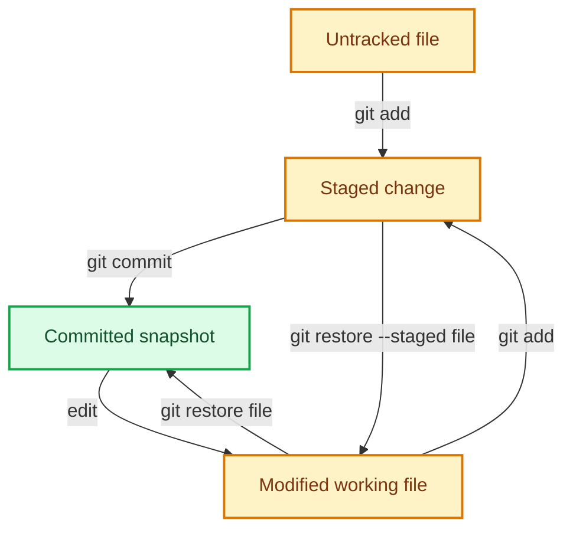
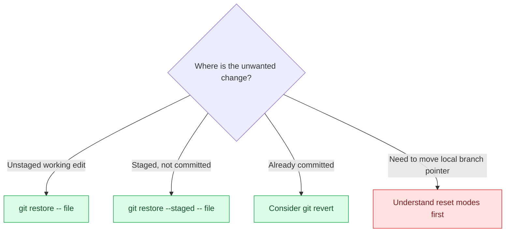

# Day 2 — File lifecycle, inspection and safe undo

## Syllabus
- Repository state lifecycle
- tracked/untracked/modified/staged/deleted/renamed files
- status short/porcelain
- diff, diff --staged/--cached, diff HEAD
- show
- log formats
- commit anatomy and messages
- add file/directory/-A/interactive staging
- .gitignore patterns/negation/already-tracked caveat
- restore working-tree and staged changes
- reset soft/mixed/hard
- revert
- amend
- clean preview and risks.

## Practical deliverable
In a disposable repository, create, stage, unstage, modify, discard, amend and revert changes; document before/after state.

## Interview focus
Reset vs revert vs restore; diff variants; partial staging; ignoring tracked files.

## Quiz focus
Status interpretation, staged/unstaged diffs, ignore rules and safe undo selection.

## Session records
| Session/date | Topics covered | Status | Evidence | Next step |
|---|---|---|---|---|
| | | Not started | | |

## Commands demonstrated vs actually run
- Demonstrated:
- Run by learner:
- Output/evidence:

## Quiz and interview outcome
- Quiz score/gaps:
- Interview questions and answers:
- Remediation / revision:

## Continuation checkpoint
- Verified topics:
- Incomplete topics:
- Blockers:
- Exact next topic:

Do not mark this day verified until the syllabus, practical, quiz and interview preparation have been reviewed.

## Visual guide — inspect before you undo

### File lifecycle

### Which diff am I inspecting?

| Command | Comparison | Use it to answer |
|---|---|---|
| `git diff` | Working tree vs index | What have I edited but not staged? |
| `git diff --staged` | Index vs last commit | What will the next commit contain? |
| `git diff HEAD` | Working tree + index vs HEAD | What differs from the last commit overall? |

### Safe undo decision path

> [!WARNING]
> `git reset --hard` and `git clean` can permanently discard uncommitted work. Preview and practise only in a disposable repository.
