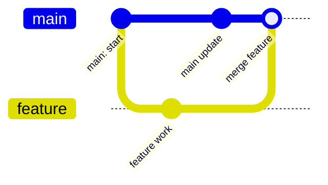
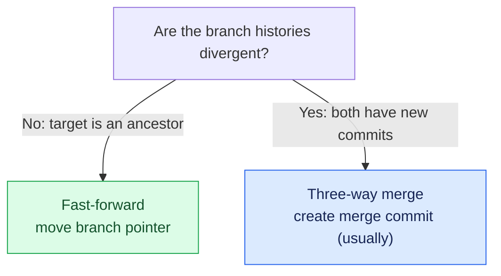
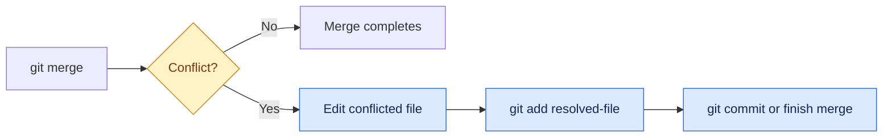

# Day 3 — Branching, merging and conflicts

## Syllabus
- Why branches exist
- branch pointers/commit graph
- branch list/create/delete/rename
- upstream tracking
- switch and legacy checkout
- switch -c
- detached HEAD
- feature branch workflow
- fast-forward vs three-way merge
- merge commit
- conflict causes/markers/ours/theirs
- manual resolution
- status/add/complete/abort
- merge options/strategies
- branch cleanup
- GitHub Flow, Git Flow and trunk-based development.

## Practical deliverable
Create two feature branches that change the same file; create and resolve a conflict; document commit graph.

## Interview focus
Branch pointer, HEAD, fast-forward, three-way merge and conflict resolution.

## Quiz focus
Branch operations, merge outcomes, conflict markers and safe branch cleanup.

## Session records
| Session/date | Topics covered | Status | Evidence | Next step |
|---|---|---|---|---|
| | | Not started | | |

## Commands demonstrated vs actually run
- Demonstrated:
- Run by learner:
- Output/evidence:

## Quiz and interview outcome
- Quiz score/gaps:
- Interview questions and answers:
- Remediation / revision:

## Continuation checkpoint
- Verified topics:
- Incomplete topics:
- Blockers:
- Exact next topic:

Do not mark this day verified until the syllabus, practical, quiz and interview preparation have been reviewed.

## Visual guide — branches are movable names for commits

### Feature branch and merge

### Two common merge outcomes

### Conflict resolution loop

> [!TIP]
> A branch is not a separate copy of your entire project. It is a movable reference to a commit.
