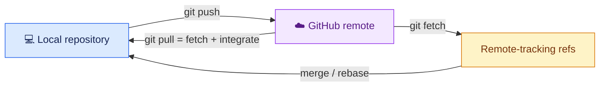
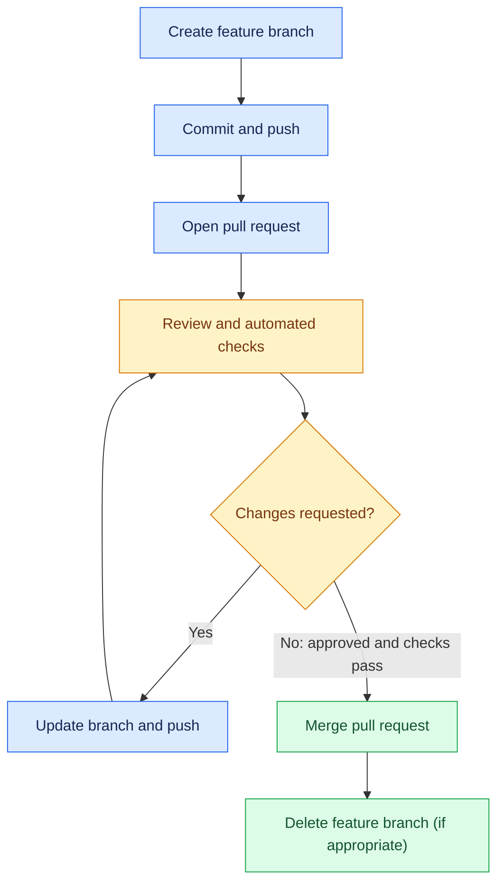

# Day 4 — GitHub and team collaboration

## Syllabus
- GitHub account/profile
- public/private repositories
- create remote and connect local
- remote -v/add/set-url/rename/remove
- origin
- clone
- remote-tracking branches
- fetch/pull/push
- fetch vs pull and merge/rebase configuration
- HTTPS vs SSH, SSH keys/agent, token safety/credential manager
- upstream/fork/sync
- pull request lifecycle, reviews, checks, approvals and merge methods
- issues/labels/assignees/milestones/discussions/projects
- README/LICENSE/CONTRIBUTING/CODE_OF_CONDUCT/SECURITY/templates
- review etiquette and permissions.

## Practical deliverable
Publish repository, create/push branch, open PR, review, address feedback and merge.

## Interview focus
Clone vs fork; origin vs upstream; fetch vs pull; PR vs push.

## Quiz focus
Remote tracking, authentication choices, PR lifecycle, review and repository documentation.

## Session records
| Session/date | Topics covered | Status | Evidence | Next step |
|---|---|---|---|---|
| | | Not started | | |

## Commands demonstrated vs actually run
- Demonstrated:
- Run by learner:
- Output/evidence:

## Quiz and interview outcome
- Quiz score/gaps:
- Interview questions and answers:
- Remediation / revision:

## Continuation checkpoint
- Verified topics:
- Incomplete topics:
- Blockers:
- Exact next topic:

Do not mark this day verified until the syllabus, practical, quiz and interview preparation have been reviewed.

## Visual guide — local Git and GitHub collaborate

### Push, fetch and pull

### Pull request lifecycle

> [!WARNING]
> Never paste a personal access token, password or private SSH key into a repository, issue, screenshot or chat.
