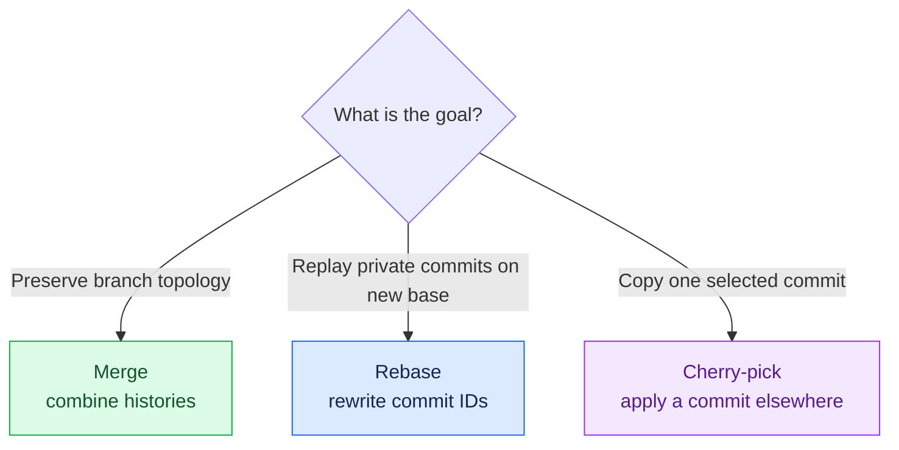
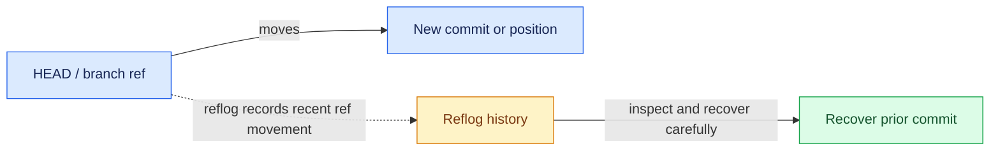

# Day 5 — Advanced everyday Git and history editing

## Syllabus
- Stash push/list/show/apply/pop/drop/clear and untracked files
- lightweight/annotated tags
- releases and semantic versioning
- rebase and interactive rebase (pick/reword/edit/squash/fixup/drop/reorder)
- conflict continue/skip/abort
- shared history caution
- cherry-pick
- reflog
- reset modes
- revert ranges/merge mainline
- force vs force-with-lease
- revision syntax HEAD~n, HEAD^, A..B and A...B.

## Practical deliverable
In a disposable repository, clean messy local history, recover a moved branch, tag a release and stash work.

## Interview focus
Rebase vs merge; cherry-pick vs merge; reflog recovery; force-with-lease.

## Quiz focus
History editing, revision syntax, stash/tag, reflog and shared-history safety.

## Session records
| Session/date | Topics covered | Status | Evidence | Next step |
|---|---|---|---|---|
| | | Not started | | |

## Commands demonstrated vs actually run
- Demonstrated:
- Run by learner:
- Output/evidence:

## Quiz and interview outcome
- Quiz score/gaps:
- Interview questions and answers:
- Remediation / revision:

## Continuation checkpoint
- Verified topics:
- Incomplete topics:
- Blockers:
- Exact next topic:

Do not mark this day verified until the syllabus, practical, quiz and interview preparation have been reviewed.

## Visual guide — choose the right history tool

### Rebase vs merge (conceptual)

### Recovery mental model

> [!WARNING]
> Rebase rewrites commit identities. Do not rewrite shared history without team agreement; prefer `--force-with-lease` over blind force push when a force update is genuinely required.
