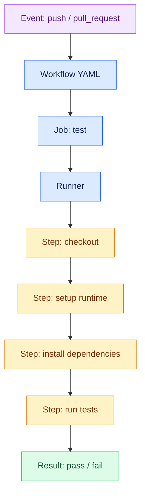

# Day 6 — GitHub platform, automation, quality and security

## Syllabus
- Actions mental model: workflow/event/job/step/runner/action
- YAML
- workflow location and push/pull_request triggers
- simple CI checkout/setup/install/test
- jobs/dependencies/matrices/artifacts/caches/env/outputs
- secrets/variables/least privilege/permissions
- branch protection/rulesets
- Pages
- Dependabot/dependency alerts/secret scanning/code scanning and plan availability
- CODEOWNERS/templates/labels/release automation
- environments/approvals
- CI vs CD/build/test/release/deploy.

## Practical deliverable
Configure test workflow and publish simple static site if feasible; record run URL and result.

## Interview focus
Workflow/job/step/runner; event triggers; secrets; branch protection.

## Quiz focus
Actions structure, YAML, CI/CD distinctions, secret handling and protections.

## Session records
| Session/date | Topics covered | Status | Evidence | Next step |
|---|---|---|---|---|
| | | Not started | | |

## Commands demonstrated vs actually run
- Demonstrated:
- Run by learner:
- Output/evidence:

## Quiz and interview outcome
- Quiz score/gaps:
- Interview questions and answers:
- Remediation / revision:

## Continuation checkpoint
- Verified topics:
- Incomplete topics:
- Blockers:
- Exact next topic:

Do not mark this day verified until the syllabus, practical, quiz and interview preparation have been reviewed.

## Visual guide — a CI workflow

### Workflow structure

### Security boundary checklist

- Grant workflows only the permissions they need.
- Store credentials in GitHub Secrets or an approved identity flow; never hard-code them.
- Treat pull-request code from forks as untrusted.
- Pin third-party actions to reviewed versions/SHAs where appropriate.
- Protect important branches with required checks and review rules.

> [!IMPORTANT]
> A green CI check proves only that configured checks passed for that run. It does not prove the application is secure or bug-free.
