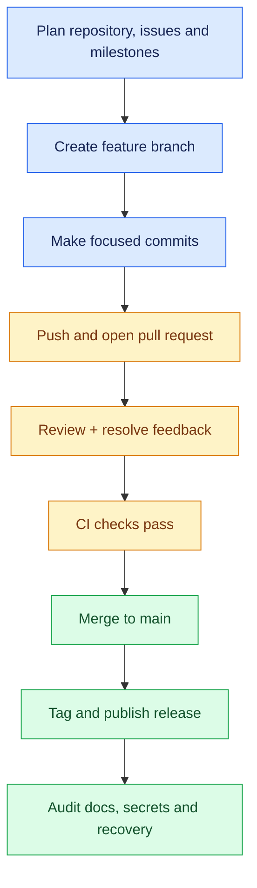

# Day 7 — Integrated capstone and mock interview

## Syllabus
- Plan repository purpose/README/license/folders/contribution guide
- issues and milestones
- feature branches/focused commits
- push branches/open PRs
- review/request changes/address feedback
- realistic conflict
- fetch/rebase/merge sync
- automated tests/CI/status checks
- tag release/release notes
- recover deliberate mistake
- audit documentation/history/branch protection/secrets
- full mock interview
- retrospective and next advanced topics.

## Practical deliverable
Deliver end-to-end capstone repository a reviewer can understand, clone, test and inspect.

## Interview focus
Integrated fundamentals, command output, branching, collaboration, recovery and CI/CD.

## Quiz focus
Integrated knowledge, practical decision-making, troubleshooting, safe operations and technical communication.

## Session records
| Session/date | Topics covered | Status | Evidence | Next step |
|---|---|---|---|---|
| | | Not started | | |

## Commands demonstrated vs actually run
- Demonstrated:
- Run by learner:
- Output/evidence:

## Quiz and interview outcome
- Quiz score/gaps:
- Interview questions and answers:
- Remediation / revision:

## Continuation checkpoint
- Verified topics:
- Incomplete topics:
- Blockers:
- Exact next topic:

Do not mark this day verified until the syllabus, practical, quiz and interview preparation have been reviewed.

## Visual guide — capstone delivery pipeline

### Definition of done

| Evidence | Acceptance question |
|---|---|
| Repository and documentation | Can another developer understand and clone it? |
| Branches, commits and PR | Is the change history focused and reviewable? |
| Tests / CI | Can a reviewer see successful checks? |
| Release / tag | Is the delivered version identifiable? |
| Recovery exercise | Can you explain and demonstrate a safe recovery? |
| Security review | Are secrets absent and permissions appropriate? |

> [!TIP]
> The capstone is assessed from reviewed deliverables and your explanation—not from the number of commands memorised.
