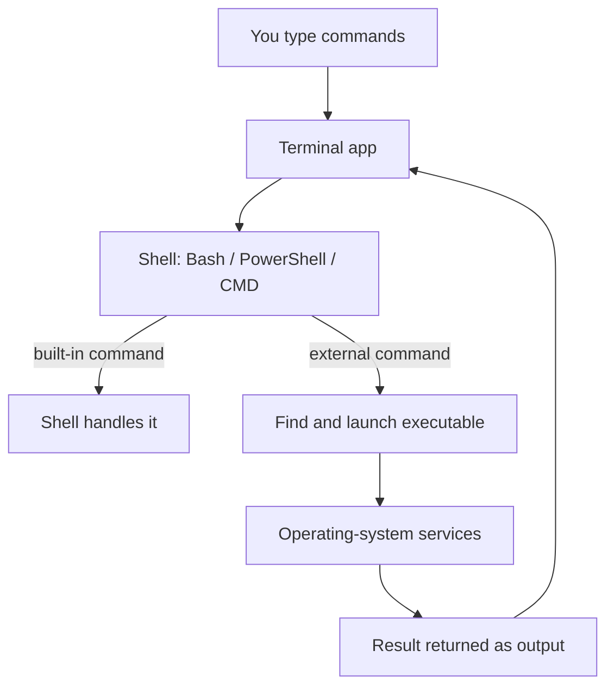
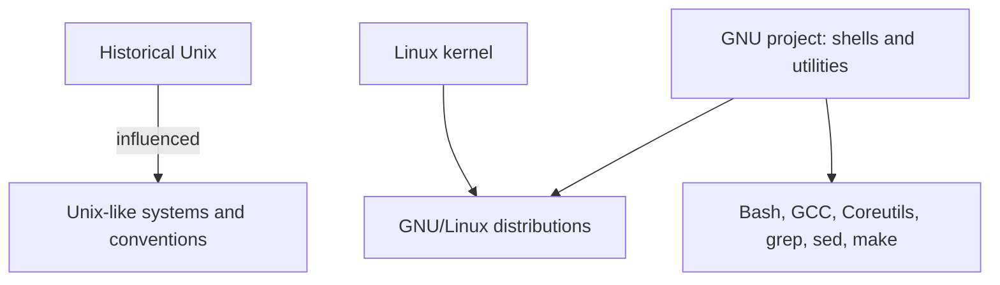
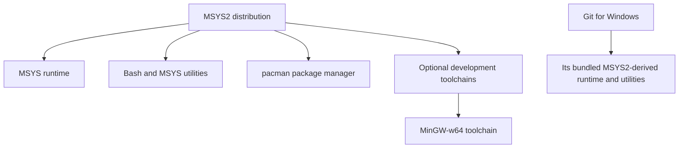
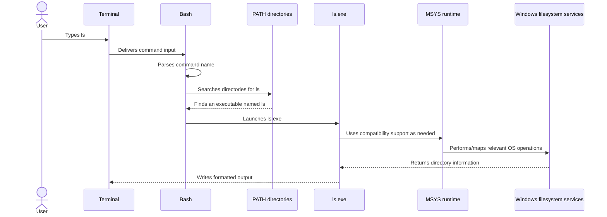
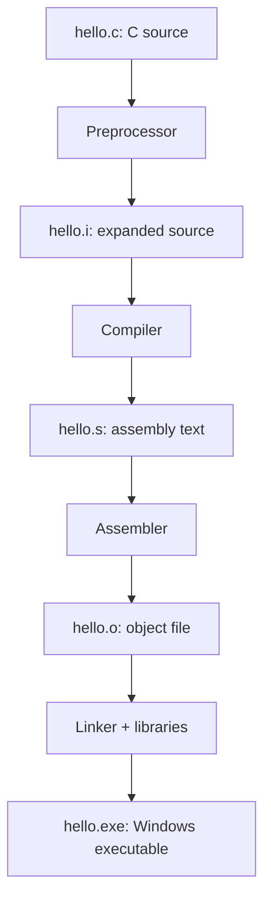

# Windows Command Line, Bash, Git Bash, MSYS2 and MinGW

<text>

> Supplementary reference — supporting operating-system and command-line concepts discussed alongside the Git course. This is not a separate bootcamp day or a change to the official curriculum.

## 1. Terminal, CLI and shell are different concepts

- **CLI (command-line interface):** a way of interacting with a program or operating system by entering text commands. CLI describes an interface, not a specific program.
- **Terminal:** the application or interface that provides text input and output. It hosts or connects to a command-line program.
- **Shell:** the command interpreter that reads commands, parses them, runs built-ins or launches other programs, and coordinates input/output.
- **CMD:** the Windows command interpreter, usually `cmd.exe`.
- **PowerShell:** a separate Windows shell and scripting environment. PowerShell commands often use cmdlets and objects rather than only Unix-style text streams.
- **Bash:** “Bourne Again Shell”, a shell from the GNU project. Bash is one shell; it is not the terminal and not the operating system.

A terminal can host different shells. For example, Windows Terminal can host PowerShell, CMD, or Git Bash.

### Mental model



The terminal presents the interaction; the shell interprets commands. The shell may execute some commands itself or launch a separate executable.

## 2. Unix, GNU and Linux

- **Unix** is a historical operating-system family that originated at Bell Labs. It influenced many modern operating systems and command-line conventions.
- **GNU** is a free-software project whose name is a recursive acronym: “GNU's Not Unix!”. It began in 1983 with the goal of building a free Unix-compatible operating system and tool collection.
- GNU provides widely used tools such as Bash, GCC, Coreutils, grep, sed and make.
- **Linux** is a kernel created by Linus Torvalds, first released in 1991. Linux is not the GNU project and is not the original Unix.
- Many operating-system distributions combine the Linux kernel with GNU tools and other components; these are often called GNU/Linux distributions.
- macOS is Unix-certified; Linux is generally described as Unix-like rather than the original Unix.

### Relationship (simplified)



Bash is a shell developed as part of GNU. Git is a separate version-control program; it is not a component of Bash or GNU.

## 3. What Git Bash is — and is not

**Git for Windows** packages Git for Windows and provides Git Bash: a Bash-based command-line environment with Unix-style utilities and the compatibility components those utilities need.

Git Bash:
- runs on Windows;
- provides Bash and utilities such as `ls`, `cat`, `grep`, `sed` and other tools;
- uses an MSYS2-derived runtime/compatibility environment;
- does **not** turn Windows into Linux;
- does **not** require the user to install the full MSYS2 distribution separately.

Git can also be invoked from PowerShell or CMD. Bash is not a requirement for Git itself.

## 4. MSYS runtime vs MSYS2 vs MinGW-w64

These names are related, but they are not interchangeable.

| Name | Meaning | Main purpose |
|---|---|---|
| **MSYS runtime** | The compatibility runtime used by MSYS-targeted programs (including the MSYS runtime DLL) | Provides POSIX-like compatibility on Windows, including relevant path and process handling |
| **MSYS2** | A Windows software distribution and development environment | Supplies the MSYS runtime, shell, Unix-style tools, package manager `pacman`, and optional development toolchains |
| **MinGW-w64** | A toolchain project for building native Windows programs using GNU tools and Windows headers/libraries | Builds Windows-native executables, commonly including GCC-based toolchains |

### Containment / relationship



Important distinctions:

- MSYS2 is the broader distribution; the MSYS runtime is one component within it.
- A separately installed MSYS2 and Git for Windows have separate installations and bundled runtime files. Git for Windows is based on MSYS2 technology, but it is not simply using the user's separate MSYS2 installation.
- Git for Windows bundles the compatibility components it needs. Installing Git for Windows does not require separately installing full MSYS2 or MinGW-w64.
- MinGW-w64 is not a prerequisite for Bash, Git or `ls`.
- MSYS2 can install and manage MinGW-w64 toolchains, but MinGW-w64 toolchains can also be obtained independently.
- MSYS-targeted programs use the MSYS runtime. MinGW-w64 programs are built to target the native Windows environment and generally do not depend on the MSYS runtime when running.
- The `MINGW64` label sometimes seen in a Git Bash prompt is an environment indicator; it does not prove that a full GCC/MinGW-w64 compiler toolchain is installed.

## 5. What happens when you type `ls`?

`ls` is an actual program/utility that lists directory contents. In Git Bash or MSYS2, it is normally provided as an executable file, commonly named `ls.exe`.

Illustrative locations:

- Git for Windows: `C:\Program Files\Git\usr\bin\ls.exe`
- MSYS2: `C:\msys64\usr\bin\ls.exe`

These are common example paths, not guarantees. The installation directory and package layout can vary.

If both Git for Windows and MSYS2 are installed, each environment has its own copy of its shell, utilities and runtime. Their `ls` programs serve the same purpose, but they are separate installed executables and may differ in version/build.

### Execution flow



The exact internal calls vary by build and operation, but this is the useful conceptual model.

**Crucial correction:** MSYS does not translate the text `ls` into the Windows command `dir`. Bash finds an `ls` executable, and that executable performs the listing. The MSYS runtime provides compatibility support for MSYS-built programs; Windows supplies the underlying operating-system services.

### What is PATH?

`PATH` is an environment variable containing directories that a shell searches for executable programs when you enter a command without a path.

For example, a Git Bash PATH may include `/usr/bin`, which maps inside the Git for Windows installation to a directory such as `C:\Program Files\Git\usr\bin`.

The exact search order matters if more than one installation provides a program with the same name. The shell runs the first matching executable it finds according to its command lookup rules and PATH order.

## 6. Unix-style paths on Windows

A Git Bash/MSYS-style path such as:

```text
/c/Users/Amit
```

typically refers to the Windows directory:

```text
C:\Users\Amit
```

The MSYS environment provides path handling and conversion where needed so Unix-style tools can work with Windows paths. This does not mean every program or every path is blindly rewritten. Native Windows programs and MSYS-targeted programs can have different path expectations.

## 7. What is a toolchain? Where does GCC fit?

A **toolchain** is a set of compatible development tools used together to turn source code into a runnable program. A typical compiled-language toolchain can include:

- compiler and preprocessor;
- assembler;
- linker;
- headers and libraries;
- debugger and supporting build tools.

**GCC** means GNU Compiler Collection. It is a compiler collection and driver that coordinates stages of compilation. It is not exclusively a Unix compiler; it can target multiple platforms, including Windows through suitable toolchains such as MinGW-w64.

### Simplified C build pipeline



The GCC driver commonly coordinates these tools. The stages can be requested separately:

| Illustrative command | Result |
|---|---|
| `gcc -E hello.c -o hello.i` | Preprocessed source |
| `gcc -S hello.i -o hello.s` | Assembly output |
| `gcc -c hello.c -o hello.o` | Object file; no final link |
| `gcc hello.o -o hello.exe` | Link object file into executable |
| `gcc hello.c -o hello.exe` | Compile and link in one driver invocation |

An object file is not the same as a C++ object or necessarily a runnable program. It contains machine-code sections and metadata such as symbols and relocation information. The linker resolves references and combines the required object files/libraries to produce the final executable. Some library dependencies may remain dynamic rather than being copied into the executable.

## 8. Key distinctions to retain

| Do not confuse | Correct distinction |
|---|---|
| Terminal vs shell | Terminal presents input/output; shell interprets commands |
| CLI vs Bash | CLI is an interaction style; Bash is a particular shell |
| Bash vs Linux | Bash is a shell; Linux is a kernel |
| GNU vs Linux | GNU is a software project; Linux is a kernel |
| Git vs GitHub | Git is version-control software; GitHub hosts Git repositories and collaboration features |
| Git vs Bash | Git is a separate program that can run from many shells |
| MSYS runtime vs MSYS2 | Runtime is a component; MSYS2 is a broader distribution |
| MSYS2 vs MinGW-w64 | MSYS2 is an environment/package distribution; MinGW-w64 is a Windows-targeting toolchain project |
| `ls` vs `dir` | They are different programs/commands that can list directory contents |
| `ls` vs Bash | `ls` is normally an external utility; Bash is the shell that locates and launches it |
| Object file vs executable | Object files are linker inputs; an executable is the linked program |

## 9. Accuracy notes

- Paths shown above are illustrative common defaults. Do not assume a user's installation is at those exact locations.
- The implementation details of MSYS path conversion and process handling depend on the program build and invocation context.
- Not every Unix program runs on Windows merely because Bash is installed. It must be available in a Windows-compatible build/environment, and any required runtime dependencies must be present.
- Git for Windows' MSYS2-derived environment is distinct from installing the full MSYS2 distribution.
- Installing Git for Windows is sufficient for Git Bash and its bundled utilities; a separate MinGW-w64 compiler installation is only needed when the user wants that development toolchain.

## 10. Scope and evidence

These notes summarize concepts discussed in the supplementary conversation on 2026-11-03. They are reference material, not evidence that the learner installed MSYS2, MinGW-w64, GCC or any additional software. The learner previously supplied global Git identity output in a separate course context, but that does not establish the installation of these additional tools.

No course syllabus status is changed by adding this reference.
</text>
