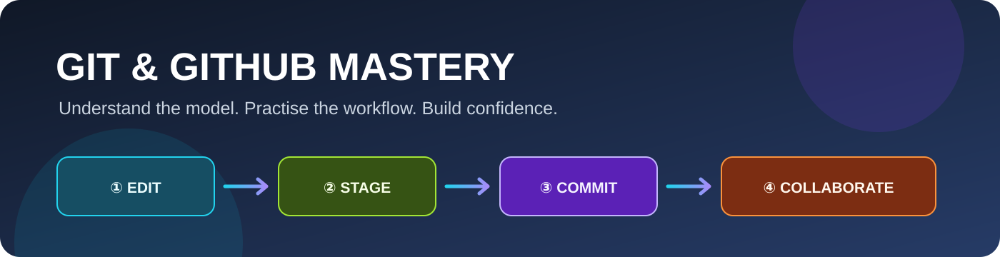
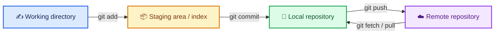

# Git & GitHub Mastery Course

  

  
  
  
  

> [!NOTE]
> This is a hands-on course. A topic is not complete merely because it has been explained: practical evidence and understanding must be checked.

## Learning path

| Stage | Focus | Deliverable |
|---|---|---|
| **Days 1–7** | Foundations, safe undo, branches, collaboration, advanced Git, Actions/security and capstone | Integrated GitHub workflow |
| **Modules A–L** | Internals, history, merging, scale, workspaces, configuration, security, Actions, administration, releases, recovery and interoperability | Advanced professional skills |
| **Projects 1–8** | Progressive individual and team-style practice | Reviewed project evidence |

## The Git workflow at a glance

## Start here

1. [Course status](COURSE_STATUS.md) — verified checkpoint and next task.
2. [Master course planner](MASTER_COURSE_PLANNER.md) — complete syllabus and governing teaching contract.
3. [Syllabus tracker](SYLLABUS_TRACKER.md) — progress across days, modules and projects.
4. [Progress log](PROGRESS_LOG.md) — dated learning evidence.
5. [Day-wise lessons](DAY_WISE/README.md) — seven foundational days.
6. [Assessments](ASSESSMENTS.md) — quizzes and interview practice.
7. [Command reference](COMMAND_REFERENCE.md) — commands taught and practised.

## Day-wise lesson map

| Lesson | Visual learning focus | Record |
|---|---|---|
| Day 1 | Git mental model, file states and first commit | [Foundations](DAY_WISE/day-01-foundations.md) |
| Day 2 | File lifecycle, diff layers and safe undo | [File lifecycle](DAY_WISE/day-02-file-lifecycle.md) |
| Day 3 | Branch pointers, merge paths and conflict resolution | [Branching & merging](DAY_WISE/day-03-branching-merging.md) |
| Day 4 | Local/remote collaboration and pull-request lifecycle | [GitHub collaboration](DAY_WISE/day-04-github-collaboration.md) |
| Day 5 | Stash, rebase, cherry-pick, tags and recovery | [Advanced Git](DAY_WISE/day-05-advanced-git.md) |
| Day 6 | Actions workflow, CI/CD and security boundaries | [Actions & security](DAY_WISE/day-06-actions-security.md) |
| Day 7 | Integrated end-to-end project and review | [Capstone](DAY_WISE/day-07-capstone.md) |

## Visual learning standard

Lessons progressively use:
- **Color-coded Mermaid diagrams** for workflows, state transitions, commit graphs and decision paths.
- **SVG illustrations** for stable, crisp visual summaries (see [course banner](assets/git-course-banner.svg)).
- **Terminal panels** with command, expected output and explanation kept separate from learner-run evidence.
- **Tables and checklists** for comparisons, verification and troubleshooting.
- **Knowledge checks** for recall and decision-making; answer keys stay hidden until an attempt unless study mode is requested.
- **Animated GIFs** only when motion clarifies a concept (for example, branch movement or a merge). GitHub Markdown does not provide a general-purpose animation/widget runtime; prefer accessible static diagrams when animation adds no learning value.

### Visual color key

| Color | Meaning |
|---|---|
| Blue | Working directory / active work |
| Amber | Staging area / pending decision |
| Green | Saved local commit / verified result |
| Purple | Remote repository / collaboration |
| Red | Risk, destructive operation or unresolved conflict |

## Teaching and evidence rules

Every substantial topic follows **understand → visualise → demonstrate → guided practice → independent challenge → verify → quiz/interview**.

- Environment: Windows, Git Bash primary; PowerShell/CMD differences explained where useful.
- Commands shown by the instructor are not represented as commands run by the learner.
- Destructive commands are explained with consequences and safer alternatives first.
- Statuses: Not started · Introduced · Practised · Verified · Needs revision · Blocked.
- A topic is **Verified** only when understanding and practical evidence support it.
- Never commit passwords, tokens, private keys or other secrets.

## Source of truth and continuity

- [MASTER_COURSE_PLANNER.md](MASTER_COURSE_PLANNER.md) — governing curriculum.
- [COURSE_STATUS.md](COURSE_STATUS.md) — current verified checkpoint.
- [SYLLABUS_TRACKER.md](SYLLABUS_TRACKER.md) — topic progress.
- [PROGRESS_LOG.md](PROGRESS_LOG.md) — session history.
- [ASSESSMENTS.md](ASSESSMENTS.md) — quiz/interview records.
- [COMMAND_REFERENCE.md](COMMAND_REFERENCE.md) — commands and evidence.
- `DAY_WISE/`, `ADVANCED_MODULES/`, `PRACTICALS_PROJECTS/` — lesson and project records.

At each new session, inspect the current records and continue from the next incomplete item. Do not restart completed topics unnecessarily or infer completion from chat history alone.
